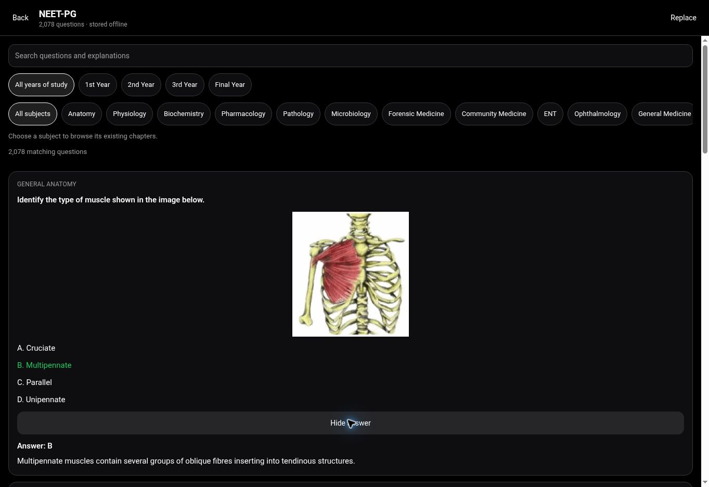
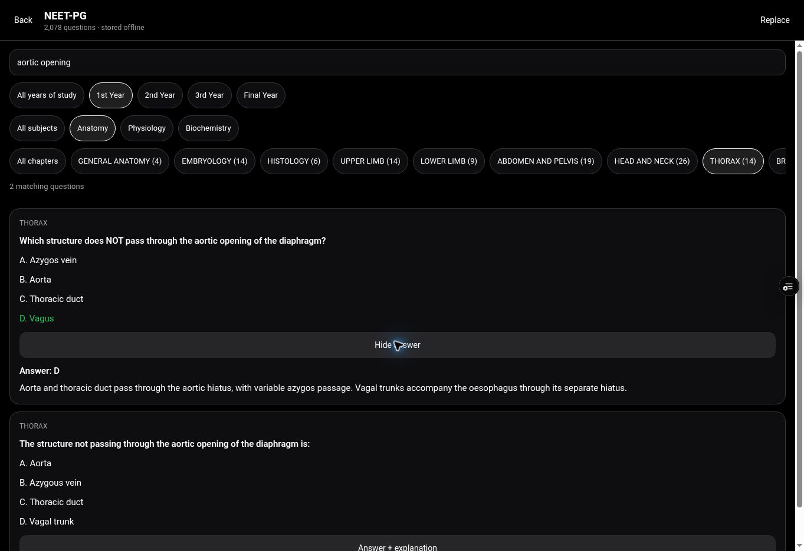

# Offline NEET PG replacement

Application commit: `169d6cc68583f3fc35b240915d669103dd287568`.

The Vault NEET PG entry now uses 2,078 included questions in 205 existing MBBS chapters, with unchanged options, supplied answers, explanations and 467 embedded illustrations. The five bundled JSON files total 21,864,843 bytes; their recombined payload matches SHA-256 `b7798fe3c8b66eab67c85df8ff56841e40974a439a8b9fd14fa00df5a9020e65`.

The previous practice dataset is unreachable through application imports. The web build excludes its retired assets, and Android packages are inspected before publication. The study interface contains no publisher names or review flags. An invalid private replacement leaves the current bank intact.

## Retrieved collection coverage

These are included records by retrieved collection label, not a claim that every original exam paper has been recovered.

| Collection | Included questions |
| --- | ---: |
| 2017 | 277 |
| 2018 | 292 |
| 2019 | 291 |
| 2020 | 281 |
| 2021 | 198 |
| 2022 | 194 |
| 2023 | 188 |
| 2024 | 122 |
| 2025 | 186 |
| 2026 | 49 |

131 records were omitted: 73 unresolved answer reviews, 23 unavailable required images, 29 incomplete option lists, one missing answer and five exact duplicates. No replacement answers or clinical illustrations were invented.

## Verification

[Generation, validation and offline browser evidence](https://github.com/Sabharivarshan111/gmck/actions/runs/39357866551) passed. This includes native/web/preview type checks, mandatory preflight checks, production web build, actual bundled-bank reload without networking, supplied-answer reveal, image viewing, chapter filters, private replacement, pagination and failed replacement recovery.

The [public Vault](https://www.orbitmbbs.site/notes) was opened through the browser and confirmed to show the 2,078-question replacement, original illustration, answer and explanation. Real 1st Year → Anatomy → Thorax filtering and search were also checked in the deployed preview. No application errors were present in the observed console logs. These are browser checks, not physical Android device testing or independent clinical certification of every answer.

Production Vercel deployment: `dpl_HtGgfPTpSf2kc5qv7Ue3VCo2DAFP`, READY, same application commit, serving `www.orbitmbbs.site` and `orbitmbbs.vercel.app`.

All native builds completed successfully and published their assets: [signed release APK/AAB](https://github.com/Sabharivarshan111/gmck/releases/tag/release-711), [internal APK](https://github.com/Sabharivarshan111/gmck/releases/tag/internal-530), and [debug APK](https://github.com/Sabharivarshan111/gmck/releases/tag/debug-570). Each APK and the AAB passed actual archive inspection for the replacement marker and absence of retired PG assets before publication. Version remains 27; no Play Store upload was performed. Exact artifact URLs and checksums are in `NEET_PG_REPLACEMENT_ARTIFACTS.json`.

PR #103 merged through the ordinary GitHub merge API as `8cd9ff7b27001af065b953b3ca2a6186dc85d033`. Subsequent release-record changes do not alter the verified application payload. Existing main-branch anatomy release gates remain intact.

